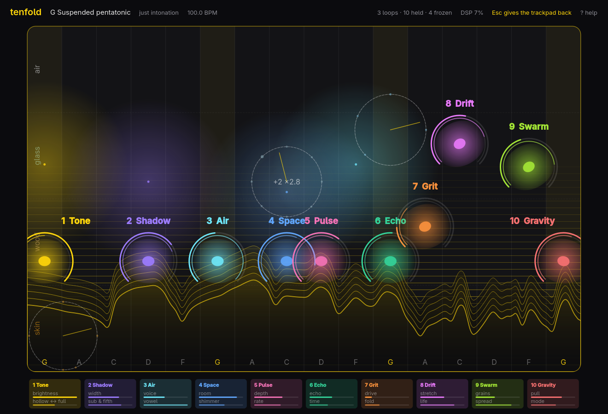

# tenfold



tenfold turns the trackpad into an instrument you play with all ten fingers.
Every finger that lands strikes something. Every finger that stays turns into
a voice and takes a knob, in the order it arrived. A rhythm you tap becomes a
loop the moment you land on the next beat and hold. Pressing down keeps what
you're holding. A palm damps everything, like a hand on strings.

All of it is synthesized from scratch: no samples. Held voices are 64-partial
additive tones, taps are modal physical models, and the room is a 16-line
feedback delay network. It runs at 48 kHz in 128-frame PipeWire callbacks
(2.7 ms).

## Playing

Space hands the trackpad to tenfold: the pointer stops and the pad becomes the
instrument. Esc gives it back. tenfold also gives it back whenever its window
loses focus. Reading the pad needs root, so the first Space asks for your
password once, the same way [padtune](https://github.com/maxberggren/padtune)
does.

The pad is laid out like this:

- **Left to right is pitch,** one scale note per column, three octaves. Every
  note gets the same width, so wherever a finger lands it lands on music.
- **Bottom to top is material:** skin, wood, glass, air.

### The grammar

| Gesture | What happens |
| --- | --- |
| **Land** | The finger strikes where it lands. The material comes from height, the note from the column, the force from how hard you land. |
| **Hold** | After a fifth of a second the finger blooms into a sustained voice at its note. It also takes the next free role (below). Slide it up or down to turn the role's first knob; twist it to turn the second. Knobs stay where you leave them. |
| **Glide** | A held finger that moves slowly settles on the nearest note. A quick slide glides through the notes in between. A small rock of the finger is vibrato around the note. |
| **Tap a rhythm, then land on the next one and stay** | The taps become a loop. Its length runs from the first tap to the finger you're holding, which is the next "one". Your first loop sets the tempo; later loops snap to half, double or the same bar and land on the beat, but keep your own timing inside. |
| **While holding a loop** | Slide sideways to transpose it through the scale. Slide up or down to move it through the materials (a drum pattern becomes a bell pattern). Twist right to roll hits into ratchets and add ghost notes, or left to thin it out. Press harder to accent and double the rolls. Taps with other fingers are added to the loop. |
| **Let go of a loop** | It keeps playing and slowly wears away like old tape: quieter, darker, looser in time each cycle. Tap once and hold on its ring to pick it up again. |
| **Press** (click the pad) | Keeps what you're holding. Held voices freeze into the landscape and your fingers are free for the next chord. A held loop is pinned and stops eroding. |
| **Palm** | Damps everything, more the more palm. Palm and press clears the whole landscape into its own reverb. |

### The ten roles

Each held finger takes the lowest role no other held finger has. Knobs are
relative, like a real knob you grab: putting a finger down never makes a value
jump.

| # | Role | Slide | Twist |
| --- | --- | --- | --- |
| 1 | Tone | brightness (spectral tilt) | hollow ↔ full (odd vs even partials) |
| 2 | Shadow | stereo width (detuned, panned partials) | sub-octave and fifth |
| 3 | Air | voice: from pure tone to breath and formants | vowel, u–o–a–e–i |
| 4 | Space | room size and decay, up to near-endless | octave shimmer |
| 5 | Pulse | depth of a tempo-locked swell on the voices | rate, a bar to sixteenths |
| 6 | Echo | tape echo amount and feedback | time, synced to the tempo |
| 7 | Grit | drive (2× oversampled) | wavefold |
| 8 | Drift | inharmonic stretch: string to bell to metal | life: slow random motion of every partial |
| 9 | Swarm | grain cloud density, sprayed from the instrument itself | grain pitch spread: octaves, fifths, reversed |
| 10 | Gravity | how hard notes pull to the scale | mode, from brightest to darkest |

Gravity's twist re-harmonizes everything already playing. Loops store scale
degrees, not pitches, so they follow a mode or key change too.

### Keys

| Key | Action |
| --- | --- |
| Space | Take the trackpad / give it back |
| Esc | Give the trackpad back |
| ← → | Key down or up a fifth |
| ↑ ↓ | Scale family: diatonic, pentatonic, harmonic minor, In, overtones |
| J | Just intonation (default) or equal temperament |
| Backspace | Dissolve the newest layer |
| Shift+Backspace | Dissolve everything |
| 0 | Knobs back to where they started |
| R | Record to `~/Music/tenfold/` (24-bit WAV) |
| F | Full screen |
| ? | All of this, in the window |
| Q | Quit |

## The sound

- **Voices** are additive: 64 partials per ear, each a quadrature oscillator
  advanced by one complex multiply per sample, in loops the compiler
  vectorizes. Timbre is shaped in the spectrum itself (tilt, odd/even,
  formant envelope, inharmonic stretch), recomputed every 64 samples, and
  loudness is held constant as the timbre moves. Each partial has its own
  detune and pan, and its own slow random walk. Partials fade out before
  17 kHz, so nothing aliases. Breath is noise through a comb tuned to the note
  and then through the vowel's formants.
- **Strikes** are 12-mode resonator banks (complex one-poles). Skin has
  membrane ratios and a pitch drop, wood a tuned bar, glass church-bell
  partials, air an inharmonic metal cluster with a noise burst. Between two
  rows the mode ratios glide geometrically, so the middle of the pad sounds
  like materials that don't exist. Softer hits lose their upper modes. Loop
  hits start at their exact sample inside the audio block.
- **The room** is a 16-line feedback delay network mixed by a fast
  Walsh–Hadamard transform, with a chorused and damped line each. Its shimmer
  pitch-shifts the tail an octave up and feeds it back in. The tape echo
  slides to new delay times instead of clicking. The grain cloud resamples
  the last four seconds of the instrument. A lookahead limiter catches
  everything at −1 dBFS.
- **Timing** comes from the kernel: the helper stamps every touch on the
  monotonic clock, the same clock the audio engine runs on.

## Without a trackpad

Every part of the instrument can be driven from a script, which is how it is
tested and how the demo is made:

```bash
tenfold demo demo.wav --json        # render the built-in 68-second demo
tenfold render my.tf out.wav        # render your own performance
tenfold bench                       # ten held voices, a frozen chord, twelve dense loops, everything up
tenfold screenshot shot.png --at 50 # the window, mid-performance
```

`tenfold demo-script` prints the demo's script, and `src/offline.h` documents
the script language (`down`, `move`, `glide`, `up`, `tap`, `click`, `key`).

## Building

```bash
bin/build      # qmake6 + make into build/tenfold
bin/test       # the gesture grammar, the tuning, and the engine's stability
bin/install    # package and install, so it shows up in the launcher
```

Needs Qt 6 (base, declarative), PipeWire and polkit. Built with `-O3
-ffast-math` for the CPU it's built on. On an M2, the worst-case bench uses
about 4% of each audio callback on average and under 20% at its peak.
